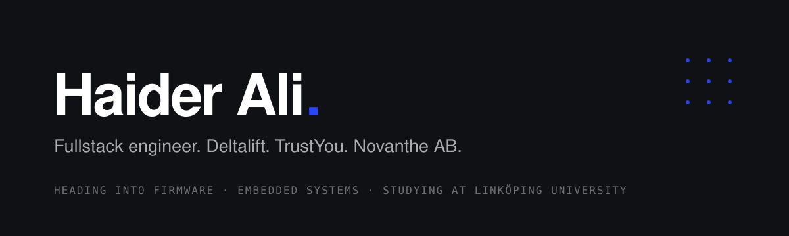

  

**Fullstack engineer. Deltalift. TrustYou. Novanthe AB.** 
**Heading into Firmware. Embedded systems. Studying at Linköping University!**

## What I've built

**[Deltalift](https://www.deltalift.cc)** · [App Store](https://apps.apple.com/us/app/deltalift-gym-rank-up/id6779003925) · [Google Play](https://play.google.com/store/apps/details?id=com.gym.analysis) 
A strength tracker I designed and built alone and shipped to both stores. Every muscle group earns its own rank from your real lifts and shows up on an anatomical heatmap. 327+ exercises with their own artwork, a 7-tier rank system, 99 XP levels, real progression charts. Offline-first, no ads, no trackers. One Flutter codebase, Supabase underneath, Firebase analytics. Hundreds of hours: product, design, code, releases, analytics, support.

**TrustYou** 
Full-stack on a React Native app built for two very different users at once, a calm side for the parent and a playful one for the child, in one codebase. The mobile app in React Native and Expo, the Firebase Cloud Functions behind it, the docs that hold them together, and the unglamorous work that keeps an app shippable: SDK and OS-target upgrades, native module migrations, release pipelines.

**[Novanthe AB](https://www.novanthe.com)** 
My software studio in Sweden. Apps, web products, AI and automation, business systems, the cloud they run on. Specified in writing, one price, handed over completely.

## Where I'm going

Everything above lives at the top of the stack. The app is the last thing that happens: the sensor already read the world, the microcontroller already made its decision, the radio already sent it. I want to be the person who builds that part.

That is why I'm at Linköping University. I'm going deep on the layer under the software I already know how to ship:

- **Firmware.** C on real hardware, memory measured in kilobytes, timing that has to be right rather than fast. Knowing what the compiler did with my code, not hoping.
- **Embedded systems.** Microcontrollers, sensors, buses and protocols, real-time behaviour, power budgets. The boundary where physics turns into data.
- **Hardware.** Reading a datasheet like a spec, understanding a schematic well enough to argue with it, and one day designing the board my code runs on.

I come at this from an unusual direction. Most embedded engineers learn to ship product software later, if ever. I already know how to take something from an idea to two app stores, keep it alive with real users, and make the analytics honest. I want to carry that discipline down to the metal: firmware that is designed before it is written, measured after it ships, and readable by the next person who opens it.

What I'm doing about it, beyond the coursework: C and systems programming, data communication down at the protocol level, and building small things that talk to real hardware. If you build devices and want someone who understands both the app in the hand and the board inside it, I'd like to hear from you.

## How I work

- **Measured first, then made.** I write down what a thing should do before I build it, and I instrument it so I know whether it did
- **Own the whole stack.** Flutter and React Native on the phone, TypeScript and Next.js on the web, Postgres and Supabase underneath. C below that, and going deeper
- **Design is part of engineering.** I decide how a screen works before I build it, and I draw a lot of what you see in my apps

## Stack

**Languages** 

**Mobile** 

**Web & backend** 

**Data** 

**Infra & tools** 

**Design** 

**Heading into** 
embedded C · microcontrollers · RTOS · sensors and buses · PCB-level understanding

## Say hello

Devices, firmware, or software that has to work: [novanthe.com](https://www.novanthe.com/en#contact).
